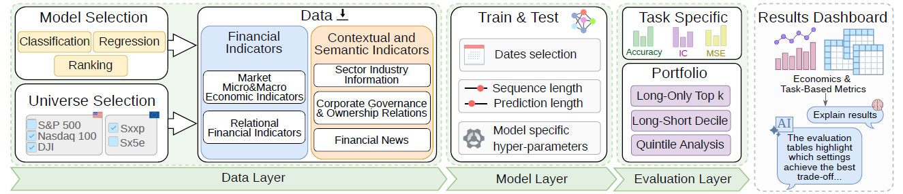

# AEQUITAS: A Toolkit for Stock Market Prediction and Portfolio Evaluation

**AEQUITAS** (An Evaluation toolkit for QUantItative and Trading AnalySis) is an interactive environment for stock market prediction and portfolio evaluation, built on top of the [FinBench](https://github.com/softlab-unimore/finbench) benchmarking framework. It supports the complete evaluation workflow from reusable dataset construction to model execution and portfolio-level result analysis and exposes it through a configurable backend and a Gradio-based graphical interface with LLM-assisted result interpretation. The demonstration video is avaible on [Youtube](https://www.youtube.com/watch?v=kzshWMwvhjM).



## Key features

- **Data Layer**: constructs reusable financial datasets from heterogeneous sources — historical prices, macroeconomic indicators, relational structures, financial news, and company metadata.
- **Model Layer**: integrates classification, regression, and ranking stock prediction models under consistent experimental settings, including temporal alignment and normalization.
- **Evaluation Layer**: maps model outputs to standardized portfolio strategies (Long-Only Top-K, Long-Short Top-K, Quintile Analysis) and reports both task-level and portfolio-level metrics.
- **Interactive Dashboard**: Gradio-based interface for configuring experiments, monitoring execution, visualizing results, and comparing model behavior across universes and market regimes.
- **LLM-Assisted Explanation**: AI module that summarizes evaluation results, highlights discrepancies between predictive and portfolio-level behavior, and supports robustness analysis.

The full list of financial indicators, variables, descriptions, and formulas is available here: [View feature tables](docs/feature_tables/README.md)

## Implemented models


| **Type**       | **Model**                                                                                    | **Loss Function**                                   | Data Normalization                                                                                                      |
|----------------|----------------------------------------------------------------------------------------------|-----------------------------------------------------|-------------------------------------------------------------------------------------------------------------------------|
| Classification | [THGNN](https://dl.acm.org/doi/pdf/10.1145/3511808.3557089)                                  | Cross-Entropy Loss                                  | -                                                                                                                       |
|                | [MAN-SF](https://aclanthology.org/2020.emnlp-main.676.pdf)                                   | Cross-Entropy Loss                                  | Relative Price Scaling (High/Low divided by previous Adjusted Close)                                                    |
|                | [Adv-ALSTM](https://arxiv.org/pdf/1810.09936)                                                | Hinge Loss                                          | -                                                                                                                       |
|                | [HGTAN](https://www.sciencedirect.com/science/article/pii/S0031320323004570)                 | Cross-Entropy Loss                                  | Per-Ticker Max Scaling (Max Normalization)                                                                              |
|                | [CNNPred2D / CNNPred3D](https://www.sciencedirect.com/science/article/pii/S0957417419301915) | MSE Loss                                            | Standardization (Z-score scaling via StandardScaler), Missing Value Imputation (fillna(0))                              |
|                | [DGDNN](https://arxiv.org/pdf/2401.01846)                                                    | Cross-Entropy Loss                                  | -                                                                                                                       |
| Regression     | [D-Va](https://dl.acm.org/doi/pdf/10.1145/3583780.3614844)                                   | MSE + Regularization + Variational + Denoising Loss | -                                                                                                                       |
|                | [ESTIMATE](https://dl.acm.org/doi/pdf/10.1145/3539597.3570427)                               | RMSE Loss                                           | Per-Ticker Max Scaling (Max Normalization)                                                                              |
|                | [StockMixer](https://ojs.aaai.org/index.php/AAAI/article/view/28681)                         | MSE Loss + Pointwise Ranking Loss                   | Per-Ticker Max Scaling (Max Normalization)                                                                              |
|                | [MASTER](https://ojs.aaai.org/index.php/AAAI/article/view/27767)                             | MSE Loss                                            | Daily Cross-Sectional Z-score Normalization (label only), Drop-Last Strategy in Training                                |
|                | [MATCC](https://dl.acm.org/doi/pdf/10.1145/3627673.3679715)                                  | MSE Loss                                            | Robust Standardization (Robust Z-score using median & IQR), Drop-Last Strategy in Training                              |
|                | [HIST](https://arxiv.org/pdf/2110.13716)                                                     | MSE Loss                                            | Robust Standardization + Daily Cross-Sectional Z-score, Missing Value Handling (Drop NaN Labels + fillna(0))            |
|                | [DiscoverPLF](https://ieeexplore.ieee.org/stamp/stamp.jsp?arnumber=10324313)                 | Reconstruction + Prediction + KL Divergence Loss    | Robust Standardization + Daily Cross-Sectional Z-score, Missing Value Handling (Drop NaN Labels + fillna(0))            |
|                | [FactorVAE](https://ojs.aaai.org/index.php/AAAI/article/view/20369)                          | Negative Log-Likelihood + KL Divergence Loss        | Robust Standardization + Daily Cross-Sectional Z-score, Missing Value Handling (Drop NaN Labels + fillna(0))            |
|                | [FinFormer](https://ieeexplore.ieee.org/stamp/stamp.jsp?arnumber=10386751)                   | Concordance Correlation Coefficient (CCC) Loss      | Robust Z-score Normalization + Missing Value Imputation + Label Filtering + Cross-Sectional Rank Normalization (CSRank) |
|                | [SAMBA](https://ieeexplore.ieee.org/stamp/stamp.jsp?arnumber=10888749)                       | MAE Loss                                            | Min-Max Scaling                                                                                                         |
| Ranking        | [STHAN-SR](https://ojs.aaai.org/index.php/AAAI/article/view/16127)                           | MSE Loss + Pointwise Ranking Loss                   | Per-Ticker Max Scaling (Max Normalization)                                                                              |
|                | [SVAT](https://dl.acm.org/doi/pdf/10.1145/3643131)                                           | MSE Loss + Pointwise Ranking Loss                   | Per-Ticker Max Scaling (Max Normalization)                                                                              |
|                | [RT-GCN](https://ieeexplore.ieee.org/stamp/stamp.jsp?arnumber=10184655)                      | MSE Loss + Pointwise Ranking Loss                   | Per-Ticker Max Scaling (Max Normalization)                                                                              |


## Quick Start

### 1. Clone the repository

```bash
git clone https://github.com/softlab-unimore/aequitas.git
cd aequitas
```

### 2. Configure environment variables

Copy the template and fill in your API keys:

```bash
cp .env_template .env
```

Open `.env` and add your OpenAI API key:

```dotenv
OPENAI_API_KEY=sk-...your-key-here...
```

The LLM-assisted explanation module requires a valid OpenAI key to summarize evaluation results and highlight cross-universe behavioral patterns.

### 3. Install dependencies

Create and activate a Python virtual environment (Python 3.10 recommended):

```bash
python3.10 -m venv venv
source venv/bin/activate   # Windows: venv\Scripts\activate
pip install -r requirements.txt
```

### 4. Launch the AEQUITAS dashboard

```bash
python app.py
```

The Gradio interface will be accessible at: 
```bash
http://localhost:7860
```


## License

This repository includes a `LICENSE` file at the project root. Review it for terms and conditions before using the code in production.

